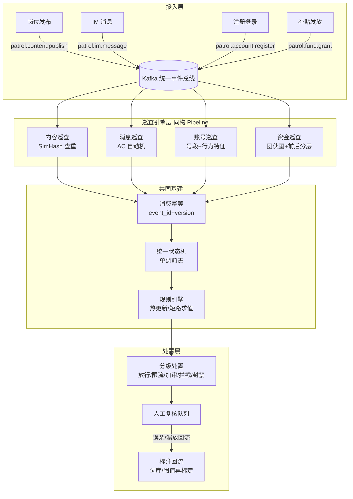

# Patrol Platform · 风控巡查平台

> 蓝领招聘平台的风控巡查体系：**一个统一引擎底座，四条巡查线**（内容 / 消息 / 账号 / 资金）。
> 本仓库是平台总览与共同基建（统一 Pipeline 抽象 + 轻量规则引擎 + 共用表结构），各巡查线核心引擎独立成仓：

| 巡查线 | 仓库 | 核心技术 | 治理目标 |
|---|---|---|---|
| 内容巡查 | [job-patrol-system](https://github.com/lifeipkg/job-patrol-system) | SimHash + 3-gram + 抽屉原理分段索引 | 黑中介洗稿岗位、信息流重复 |
| 消息巡查 | [message-patrol](https://github.com/lifeipkg/message-patrol) | AC 自动机 + 变体归一化 + 角色分级 | 飞单/私单诱导话术 |
| 账号巡查 | （本仓库叙事内） | 号段特征 + 行为序列 | 接码注册、养号 |
| 资金巡查 | （本仓库叙事内） | 团伙图 + 放款前后分层 | 补贴薅取 |

## 1. 平台架构



## 2. 核心抽象：同构 Pipeline

四条巡查线业务完全不同，但**接入与产出同构**——"事件进、PatrolVerdict 出"：

```
归一化 -> 特征提取 -> 检测(主通道+兜底通道) -> 决策
```

由此，接入层（Kafka 消费、幂等、状态机）与处置层（分级处置、复核、回流）**只写一次、四线复用**：

- `PatrolPipeline<T>`：统一接口，`domain()` 对应 Kafka topic；
- `AbstractPatrolPipeline<T>`：Template Method 固定四阶段骨架，各线只实现钩子；
- `RuleEngine`：优先级短路求值，规则快照不可变（读多写少无锁），热更新=原子换引用。

这是平台化的关键收益：**新巡查线 = 实现四个钩子 + 注册 topic**，不动任何基建。

## 3. 共同基建设计要点

| 基建 | 设计 | 解决的问题 |
|---|---|---|
| 消费幂等 | `event_id + version` 唯一键 | Kafka 重复消费导致重复处置/重复扣费 |
| 统一状态机 | 状态单调前进，只允许 `version` 更新的版本前进 | 乱序/重放消息导致状态回跳 |
| 规则引擎 | 优先级短路 + 不可变快照 + 热更新 | 策略变更频繁，不能发版 |
| 处置分层 | 同一决策按对象落地不同动作 | 一刀切误伤正常用户 |
| 标注回流 | 误杀/漏放样本闭环到词库与阈值 | 风控资产随对抗持续生长 |

表结构见 [`sql/common-schema.sql`](sql/common-schema.sql)（含 Kafka topic 规划注释）。

## 4. 快速开始

```bash
mvn verify
```

单元测试覆盖：规则引擎优先级短路、禁用规则与默认决策、Pipeline 四阶段骨架复用。

## 5. 面试要点（对应讲述节奏）

1. 先讲体系：**四条线一个底座**，投入产出比来自基建复用；
2. 再讲自己负责的线：内容巡查（主）+ 消息巡查（副），两个引擎仓库为佐证；
3. 账号/资金线：说清"协同设计，图能力由团伙识别模块提供"，不越界宣称独做；
4. 被问整体架构：按本 README 的分层图讲，从业务损失讲到抽象收益。

## 6. Roadmap

- [ ] 特征服务抽象（实时/离线特征 join，口径统一特征字典）
- [ ] 评分模型接入（规则底座之上叠加模型分）
- [ ] 团伙识别模块（Union-Find 增量连通分量）独立成仓
- [ ] 巡查指标大盘（桶倾斜/堆积/命中率/误杀率）
